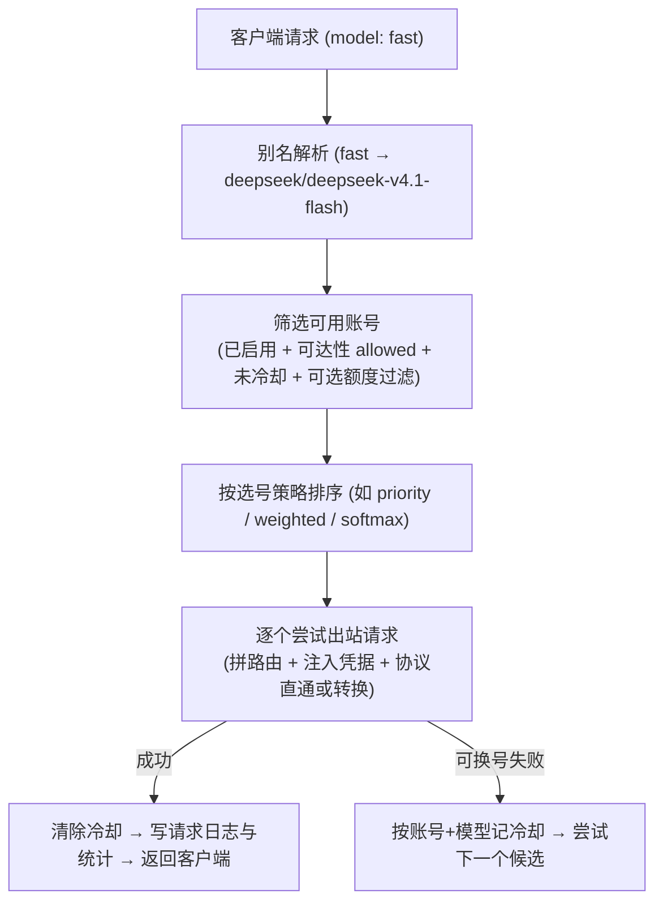

`lax` 的设计把「上游接口怎么连」「用谁的密钥发」「某个模型能不能调」「多个账号选哪个」拆成互相独立的几层。

拆开之后，更换 `API Key`、重新同步模型列表或调整选号顺序，都不会互相覆盖。

## 核心对象一眼看懂

以日常最常见的场景为例：客户端请求模型别名 `fast`，网关把它解析为 `deepseek/deepseek-v4.1-flash`，再从 `deepseek` 供应商下的 `acct-a`、`acct-b` 两个账号中选一个发出请求。

| 对象 | 回答的问题 | 管理命令 |
| --- | --- | --- |
| **供应商** | 上游 `Base URL`、协议路由、凭据头格式是什么 | `lax provider` |
| **账号** | 使用哪份 `API Key`、属于哪家供应商、优先级多少 | `lax account` |
| **模型目录** | 这家供应商提供哪些模型，价格与元数据是什么 | `lax model sync` / `add` |
| **可达性** | 具体到某一个账号，这个模型当前是否验证可用 | `lax model probe` / `add` |
| **模型别名** | 客户端写的简短名字（如 `fast`）映射到哪个真实模型 | `lax model alias` |
| **选号策略** | 同一模型有多个可用账号时，按什么规则排序尝试 | `lax route` |
| **额度快照** | 账号在上游还剩多少余额、何时到期（只读监控） | `lax quota` |



## 供应商与账号分离

供应商保存公共配置：`Base URL`、每条协议的出站路径、默认协议、凭据头写法与模型列表路径。

账号只保存 `API Key`、所属供应商、优先级与启用状态。

这种分离带来三个直接好处：

- **公共配置不重复**：同一家供应商挂多个账号（如 `acct-a`、`acct-b`）时，路由与请求头只需在供应商维护一份。
- **换密钥不丢历史**：使用 `lax account set acct-a --key <新 Key>` 更换凭据，账号原有的探活结论、权重与历史请求归属全部保留。
- **一对多归属**：一个账号只属于一家供应商；同一上游需要多份凭据分流时，新建多个账号指向同一供应商即可。

## 模型目录与可达性分开

「上游列表里有这个模型」和「当前账号真的能调用它」是两件事。

前者记录在供应商级的**模型目录**中，后者记录在账号级的**可达性**上。

| 操作 | 对模型目录的影响 | 对账号可达性的影响 | 是否消耗 token |
| --- | --- | --- | --- |
| `lax model sync` | 新增未知模型；已有记录仅补齐非空元数据 | 将新拉取的模型标为 `allowed`（待探活） | 否 |
| `lax model probe` | 补充探测到的协议与元数据 | 按真实请求结果改写为 `allowed`、`forbidden` 或 `missing` | 是（极小请求） |
| `lax model add` | 新增未知模型；已有记录不变 | 手工标为 `allowed` 并可选指定协议 | 否 |

<Callout type="info">
`lax model sync` 只做加法：它不会删除已有记录，也不会把探活已经判定为 `forbidden` 或 `missing` 的模型重新改回可用。

因此「同步过」不代表「已探活可用」，只有真实探活通过或手工 `lax model add` 声明的模型才会进入选号池。
</Callout>

## 模型名与别名

客户端可以传入真实模型名，也可以传入别名，例如将 `fast` 指向 `deepseek/deepseek-v4.1-flash`：

```bash
lax model alias set fast deepseek/deepseek-v4.1-flash
lax model alias ls
lax model alias unset fast
```

别名只在请求入站时生效：网关按解析后的真名 `deepseek/deepseek-v4.1-flash` 选号并向上游发请求，上游响应体中的 `model` 字段保持原样不重写。

- **匹配规则**：精确匹配且区分大小写，不做通配符或前缀归一。
- **链式解析**：支持别名指向另一个别名，最多解析 8 跳；存在环路时直接拒绝请求（400）并指出环上的名字。
- **防遮蔽**：别名不能与现有真实模型名同名。
- **日志体现**：`lax log tail` 会显示 `fast → deepseek/deepseek-v4.1-flash`；`--json` 输出中 `model` 为请求传入的别名，`model_used` 为解析后的真名。

## 声明的能力与账号级覆盖

### 声明的能力

模型目录上声明的能力决定了该模型可以用于哪类端点：

| 声明的能力 | 对应入站端点 |
| --- | --- |
| `chat` | 四条对话协议（`openai-chat`、`openai-responses`、`anthropic`、`gemini`） |
| `embedding` | `/v1/embeddings` 与 Gemini `:embedContent` |
| `speech` | `/v1/audio/speech` |
| `transcription` | `/v1/audio/transcriptions` |

语音端点只调度同时声明了对应能力且绑定了方言的模型。

声明的能力回答「能走哪个端点」，方言回答「上游自定义报文长什么样」。

### 账号级覆盖

同一模型在不同账号上可以有不同的协议、单价或选号权重，互不干扰：

| 覆盖项 | 写入方式 | 未设置时的回退 |
| --- | --- | --- |
| 协议 | `lax model probe`、`lax model add --protocol` 或方言绑定 | 按模型目录与供应商默认协议推导 |
| 价格 | `lax model price set <模型> --account <账号>` | 回退到供应商级标价 |
| 权重 | `lax route account set <账号> --model <模型> --weight N` | 回退到账号默认权重，再回退到 `1` |

再次执行 `lax model sync` 不会覆盖已有的账号级协议或价格设置。

## 有效出站协议如何确定

当网关选中某个账号准备转发时，按以下优先级决定出站协议：

1. 该账号在该模型上的协议覆盖（由 `lax model probe` 或 `lax model add --protocol` 写入）。
2. 模型目录声明的协议集合中若包含供应商的「有效默认协议」，优先采用该协议。
3. 否则按 `openai-chat` → `openai-responses` → `anthropic` → `gemini` 顺序取集合中的第一个。
4. 集合为空时，回退到供应商的有效默认协议。

供应商自身的有效默认协议依次取：显式设置的 `--default-protocol` → 已声明的路由 → 按 `openai-chat` → `openai-responses` → `anthropic` 回退。

`gemini`、`systemone`、`embeddings`、`speech`、`transcriptions` 不会自动成为默认协议，必须显式指定。

## 额度快照与转发边界

- **只读监控**：账号额度由 `lax quota refresh` 或 `lax serve` 后台刷新，仅保存余额与到期时间的只读快照，不做配额分配、扣减或计费，也不修改账号启用状态。
- **默认不干预选号**：只有通过 `lax route set` 显式配置 `--quota-order` 或 `--quota-min-usd` 后，额度才会参与候选过滤与排序（详见[账号额度](/self-hosted/route/quota)）。
- **CLI 与网关同路径**：`lax model call`、`decide`、`speak`、`transcribe` 会在当前进程内启动一个临时网关发起请求，与 `lax serve` 遵循完全相同的选号与转换逻辑。
- **直通与转换**：入站协议与有效出站协议相同时，对话报文原样直通；不同时经内部中间表示转换。`systemone`、`embeddings` 与语音协议不参与对话协议转换。

## 排障自查一条链

要快速看清某个模型（如 `deepseek/deepseek-v4.1-flash`）在账号 `acct-a` 上的完整状态，可按顺序执行：

```bash
lax model ls deepseek/deepseek-v4.1-flash                  # 谁提供它
lax model show deepseek/deepseek-v4.1-flash --account acct-a # 账号上的可达性与冷却状态
lax model price ls deepseek/deepseek-v4.1-flash --account acct-a # 有效单价
lax route explain deepseek/deepseek-v4.1-flash               # 下一次请求的候选顺序
```

## 下一步

- 跟踪单次请求每一步的执行细节：[请求生命周期](/self-hosted/concepts/request-lifecycle)
- 配置供应商与路由：[供应商与路由](/self-hosted/configure/providers)
- 同步、探活与手写模型：[模型管理](/self-hosted/configure/models)
- 调整多账号选号算法：[选号](/self-hosted/route)
