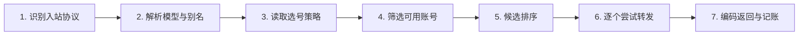

本页按时间顺序拆解一次转发请求的全部步骤。

协议字段映射见[协议转换](/self-hosted/gateway/conversion)，选号算法细节见[选号策略](/self-hosted/route/policies)，自定义失败规则见[失败处理](/self-hosted/route/failure)。

## 1. 识别入站协议

网关根据 HTTP 方法与请求路径确定入站协议：

| 方法 | 路径 | 入站协议 |
| --- | --- | --- |
| `POST` | `/v1/messages` | `anthropic` |
| `POST` | `/v1/chat/completions` | `openai-chat` |
| `POST` | `/v1/responses` | `openai-responses` |
| `POST` | `/v1beta/models/{model}:generateContent` | `gemini`（非流式） |
| `POST` | `/v1beta/models/{model}:streamGenerateContent` | `gemini`（流式） |
| `POST` | `/v1/embeddings` | `openai-embeddings` |
| `POST` | `/v1beta/models/{model}:embedContent` | `gemini` 向量化 |
| `POST` | `/v1/systemone` | `systemone` |
| `POST` | `/v1/audio/speech` | `openai-speech` |
| `POST` | `/v1/audio/transcriptions` | `openai-transcriptions` |

未知路径返回 `404`。

上述路径仅接受 `POST`，其他方法返回 `405` 并附带 `Allow: POST`。模型清单查询 `/v1/models` 与 `/v1/models/{id}` 仅接受 `GET`。

## 2. 解析模型名

网关从请求中提取模型名：`gemini` 从 URL 路径段提取，其余协议从请求体或表单字段读取。

提取后先检查别名映射，将别名解析为真实模型名（如 `fast` → `deepseek/deepseek-v4.1-flash`）。

若别名成环或解析失败，直接返回 `400` 并在错误信息中指出环路或断点。

## 3. 读取选号策略

按解析后的真实模型名查询生效的选号策略：优先读取模型级覆盖，其次读取全局默认策略，最后使用内置默认。

策略快照包含策略名称、会话粘性、权重、统计窗口、评分权重与额度选号设置。

<Callout type="warn">
若策略快照读取失败，网关直接返回 `500`，不会静默回退到隐式顺序，确保所有选号结果都可解释、可预期。
</Callout>

## 4. 筛选候选账号

候选账号必须同时满足以下条件才会进入排序：

- 账号处于启用状态；
- 账号声明提供该模型（可达性为 `allowed`）；
- 该账号上的该模型未处于冷却期；
- **可选额度过滤**：若配置了 `--quota-min-usd`，排除折合余额已知且低于阈值的账号（从未刷新或汇率未知的账号保留）；若设置了 `expiry_mode=exclude`，排除临近或已到期的账号。

停用、未提供模型或冷却中的账号均会被剔除，可通过 `lax route explain <模型>` 查看具体的排除原因（额度过滤原因以「额度：」开头）。

## 5. 排序

按当前策略（`priority`、`rotate`、`weighted`、`success` 或 `softmax`）对候选账号生成完整尝试序列。

- **会话粘性**：`prefer` 将同一会话哈希命中的账号置顶；`off` 忽略会话键；`strict` 仅保留该账号，若不可用则直接返回 `503`。
- **可选额度排序**：若开启 `--quota-order`，在策略排序与粘性之后再做一次稳定排序（余额未知的账号排在已知之后）；设置了 `expiry_mode=deprioritize` 的账号整体移至队列末尾。

## 6. 逐个尝试

对排序后的每个候选账号依次执行：

1. 计算该账号对该模型的有效出站协议；
2. 按供应商路由拼接目标地址，注入凭据头与附加请求头；
3. 若入站与出站协议一致且支持直通，原样转发请求体；否则转换请求体格式；
4. 发送上游请求并读取响应。

如果请求成功，立即清除该账号该模型的冷却状态与连续失败计数。

如果失败，按失败类型记录冷却并决定是否继续尝试下一个候选账号。

## 7. 返回与记录

- **非流式请求**：读取完整上游响应，按入站协议编码后返回客户端。
- **流式请求**：逐帧透传或解码重编码输出；若客户端中途断开，立即停止读取上游。
- **日志与统计**：每次上游尝试记录一条请求日志，同时写入按分钟聚合的选号统计。请求日志写入失败仅输出警告，不影响已发出的客户端响应。

## 失败如何分类

默认情况下，网关按以下规则处理上游错误与异常（可通过[失败处理](/self-hosted/route/failure)规则覆盖）：

| 失败来源 | 冷却与账号状态 | 是否换号重试 |
| --- | --- | --- |
| 上游 `429` | 冷却从 `500ms` 起步，随连续失败翻倍，上限 `30 分钟` | 是 |
| 上游 `5xx` | 冷却从 `10s` 起步，随连续失败翻倍，上限 `30 分钟` | 是 |
| 连接层失败（DNS、拒绝连接、TLS、读超时、无响应） | 冷却从 `2s` 起步，随连续失败翻倍，上限 `30 分钟` | 是 |
| 上游 `401` | 自动停用该账号 | 否 |
| 上游 `403` | 不停用、不冷却 | 否，原样返回 |
| 上游 `400` | 不冷却 | 否，原样返回 |
| 客户端主动断开 | 不冷却 | 否 |
| 已向客户端写出字节后流中断 | 不冷却 | 否 |

<Callout type="info">
冷却按「账号 + 模型」维度隔离：同一个账号的某个模型触发 `429` 冷却时，该账号上的其他模型不受影响。

此外，转发规则与 `lax quota refresh` 互不干扰——额度刷新遇到 `401`/`403` 仅标记快照为「凭据被拒」，不会停用账号。
</Callout>

## 不等待重试

在单次 HTTP 请求内，网关不会阻塞等待某个账号的冷却时间结束再重试。

所有可用候选都尝试失败后直接返回 `503`，把重试节奏交给客户端，避免高并发下请求堆积并放大 `429` 冷却时间。

唯一例外是在[失败处理](/self-hosted/route/failure)中显式配置了 `--retry` 的规则，网关会按规则指定的退避间隔在当次请求内重试。

## 下一步

- 了解各协议之间的转换规则：[协议转换](/self-hosted/gateway/conversion)
- 调整多账号选号策略：[选号策略](/self-hosted/route/policies)
- 定制错误码的冷却与重试规则：[失败处理](/self-hosted/route/failure)
