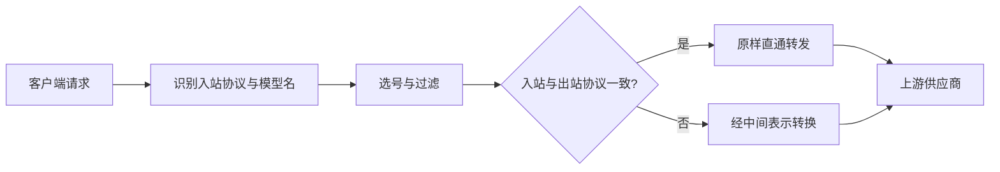

网关是 `lax` 的数据面。

启动服务后，客户端将 `Base URL` 指向网关监听地址，网关按模型名筛选可用账号、按需完成协议转换并记录每次尝试，再把响应返回给客户端。



## 启动监听与验证

使用 `lax serve` 启动网关，默认在前台监听 `127.0.0.1:4567`。

按 `Ctrl-C` 或发送 `SIGTERM` 可平滑退出。

需要临时更换端口或绑定地址时，通过 `--addr` 覆盖配置文件中的设置：

```bash
lax serve
lax serve --addr 127.0.0.1:9000
```

启动过程中，网关不会向上游发送请求，而是依次完成四项准备：

- 加载插件方言表（单个插件加载失败仅输出警告，不阻止启动）
- 回填语音声明能力对应的方言绑定
- 清理 30 天以前的按分钟聚合选号统计
- 在数据目录写入 PID 文件以供 `lax plugin reload` 定位进程

<Callout type="warn" title="监听安全">
网关默认仅绑定本地回环地址，直接暴露本机端口时不提供内置鉴权与传输加密。

需要跨机访问时，请放在 SSH 隧道、Tailscale 或内网之后，或在前端加一层反向代理完成 TLS 与访问认证。
</Callout>

服务启动后，可通过三个只读 `GET` 接口确认进程存活与模型清单：

```bash
curl -s http://127.0.0.1:4567/healthz
curl -s http://127.0.0.1:4567/v1/models
curl -s http://127.0.0.1:4567/v1/models/deepseek/deepseek-v4.1-flash
```

| 接口 | 说明 |
| --- | --- |
| `GET /healthz` | 返回网关视角的全局计数（账号、启用账号、模型与进出协议数），用于确认进程存活与数据库可读性，不主动探测上游 |
| `GET /v1/models` | 列出已启用账号声明可用的模型，按名称去重并升序排列；`owned_by` 为供应商名称 |
| `GET /v1/models/{id}` | 返回单个模型对象；未命中返回 `404` |

`/v1/models` 返回示例：

```json
{
  "object": "list",
  "data": [
    {
      "id": "deepseek/deepseek-v4.1-flash",
      "object": "model",
      "created": 0,
      "owned_by": "deepseek"
    }
  ]
}
```

两个模型接口只读且不写入请求记录，不影响冷却状态与选号。

停用账号提供的模型不会出现在清单中，冷却中的模型仍会列出；解析成功的别名也会出现在清单里，其 `id` 为别名，`owned_by` 取实际模型所属的供应商。

## 八条入站协议与十个 POST 路径

网关支持八条入站协议，共暴露十个 `POST` 路径。

所有入站路径仅接受 `POST` 请求；其他 HTTP 方法返回 `405` 并携带 `Allow: POST`，未知路径返回 `404`。

| 协议 | 入站 POST 路径 | 模型名提取位置 | 出站方式 | 参与转换 |
| --- | --- | --- | --- | --- |
| `anthropic` | `/v1/messages` | 请求体顶层 `model` | 供应商路由 | 是 |
| `openai-chat` | `/v1/chat/completions` | 请求体顶层 `model` | 供应商路由 | 是 |
| `openai-responses` | `/v1/responses` | 请求体顶层 `model` | 供应商路由 | 是 |
| `gemini` | `/v1beta/models/{model}:generateContent` | URL 路径 `{model}` 段 | 供应商路由 | 是 |
| `gemini` | `/v1beta/models/{model}:streamGenerateContent` | URL 路径 `{model}` 段 | 供应商路由 | 是 |
| `gemini` | `/v1beta/models/{model}:embedContent` | URL 路径 `{model}` 段 | 供应商路由 | 否 |
| `systemone` | `/v1/systemone` | 请求体顶层 `model` | 供应商路由 | 否 |
| `openai-embeddings` | `/v1/embeddings` | 请求体顶层 `model` | 供应商路由 | 否 |
| `openai-speech` | `/v1/audio/speech` | 请求体顶层 `model` | 供应商路由或方言 | 否 |
| `openai-transcriptions` | `/v1/audio/transcriptions` | multipart 表单 `model` 字段 | 供应商路由或方言 | 否 |

`gemini` 的模型名位于 URL 路径中，`:` 之后的后缀仅用于区分动作，不属于模型名，请求体里的 `model` 字段会被忽略。

若模型名包含 `/`，需按路径段转义（例如 `org%2Fgemini` 解析为 `org/gemini`）。

## 协议互通边界与出站推导

八条入站协议中，只有四条对话协议（`anthropic`、`openai-chat`、`openai-responses`、`gemini` 的对话动作）能够经中间表示互相转换。其余三类非对话接口仅支持同协议直通或按模型绑定的方言处理：

- `openai-embeddings` 与 `gemini` 向量化动作只处理文本向量化，没有消息角色、工具与流式语义。
- `openai-speech` 与 `openai-transcriptions` 处理音频字节流，与消息文本之间不存在可定义的结构映射。
- `systemone` 接收待判断材料与结构化问题列表，没有对话序列可映射。

| 请求情况 | 网关行为 |
| --- | --- |
| 入站与出站协议相同，且属于宿主直通协议 | 原样转发请求体与响应体 |
| 入站与出站协议不同，但均属于四条对话协议 | 经中间表示完成字段转换 |
| 入站为 `systemone`，出站为其他协议 | 返回 `400`，提示改用对话路径 |
| 入站为对话协议，出站为 `systemone` | 返回 `400`，提示改用 `/v1/systemone` |
| 入站为语音协议，但模型能力或方言不匹配 | 返回 `400`，不发送上游请求 |

有效出站协议归属在模型上，而非账号或入站路径，具体推导顺序见[有效出站协议如何确定](/self-hosted/concepts/how-it-works#有效出站协议如何确定)。

只要模型的有效出站协议符合要求，同一个账号既可以服务 `anthropic` 请求，也可以服务 `openai-chat` 请求。

## 常见路径与状态码速查

| 情况 | 状态码 |
| --- | --- |
| 未知路径或模型名不在清单 | `404` |
| 已知路径但 HTTP 方法不匹配 | `405`（响应头带 `Allow`） |
| 请求体解析失败、协议不互通或缺少声明能力 | `400` |
| 有账号提供该模型但候选全部失败或冷却中 | `503` |
| 选号策略读取失败或数据库异常 | `500` |

错误体按入站协议生成，详细字段与流式中断规则见[错误格式与流式断流处理](/self-hosted/gateway/errors)。

## 命令行协议名简写

文档正文统一使用协议全称，命令行参数同时接受以下简写：

| 简写 | 全称 |
| --- | --- |
| `openai` | `openai-chat` |
| `responses` | `openai-responses` |
| `embeddings` | `openai-embeddings` |
| `speech` | `openai-speech` |
| `transcriptions` | `openai-transcriptions` |

`anthropic`、`gemini` 与 `systemone` 的简写与全称相同。

## 下一步

- 了解跨协议字段映射与请求头叠加规则：[跨协议转换与请求头](/self-hosted/gateway/conversion)
- 查看各协议错误体与流式断流处理：[错误格式与流式断流处理](/self-hosted/gateway/errors)
- 配置向量化、语音与决策接口：[非对话接口（向量化 / 语音 / 决策）](/self-hosted/gateway/non-chat)
