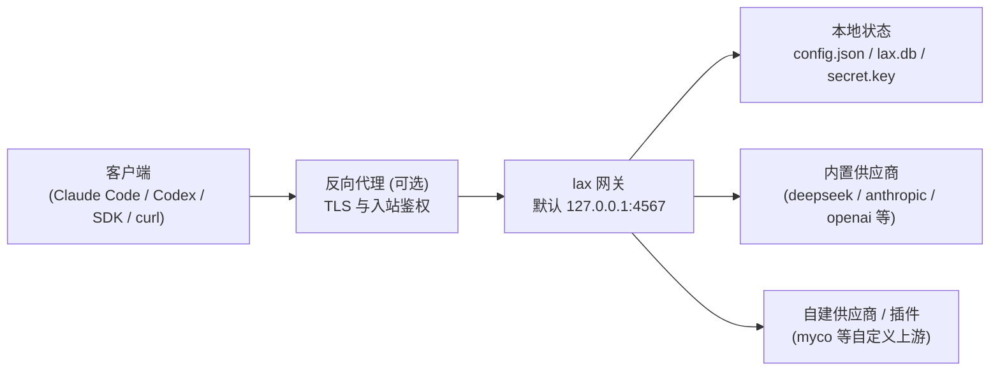

自部署是指在自己的服务器或开发机上运行 `lax` 网关。

客户端将请求发往本地或反向代理后的网关地址，所有上游凭据、模型目录、选号策略与请求日志均保存在本地数据目录，不经过任何第三方托管服务。

## 什么时候需要自部署

如果只需要开箱即用，可以直接使用[托管服务](/)。

当出现以下需求时，适合在自己的主机上部署 `lax`：

- **凭据与数据不出本地**：上游 `API Key` 经本地密钥加密后存入本地数据库，请求日志与用量统计完全留存在自有磁盘。
- **多账号池与高可用**：为同一供应商添加多个账号，结合限流冷却、权重分配、账号额度过滤与失败处理规则自动切换。
- **自定义访问控制**：在 `lax` 前方挂载 Nginx、Caddy 等反向代理，统一接入 TLS 证书、内网隔离或团队鉴权。
- **接入私有或非标上游**：通过自建供应商配置或插件，将非标准报文格式的上游纳入同一套网关协议。

| 维度 | 托管服务 | 自部署 |
| --- | --- | --- |
| 运行方式 | 直接接入托管域名 | 下载单文件二进制或源码编译后运行 `lax serve` |
| 上游凭据 | 使用托管方分配的 `API Key` | 自行添加并加密保存自有上游 `API Key` |
| 数据归属 | 由托管方维护 | 保存在本地配置与数据目录，支持迁移与备份 |
| 访问控制 | 由托管方提供认证 | 默认仅监听本机回环，对外需前置反向代理与鉴权 |

## 架构一眼看懂

`lax` 以单文件二进制运行，没有外部数据库或运行时依赖。

一次请求从客户端进入网关后，按选号顺序匹配可用账号并完成协议转换：

- **入站侧**：对外暴露统一的对话、向量化与语音端点，支持四种对话协议（`openai-chat`、`openai-responses`、`anthropic`、`gemini`）互相转换。
- **调度侧**：根据模型别名解析真名，剔除停用或冷却中的账号，再按选号策略决定尝试顺序。
- **出站侧**：按目标账号所属供应商的路由与凭据头格式发出请求，记录延迟、状态与 token 用量。

## 学习路径

按以下顺序完成从部署到日常运维的上手：

1. **[安装](/self-hosted/install)**：下载发布包或从源码编译，运行 `lax init` 生成配置文件、数据库与加密密钥，并用 `lax doctor` 检查本机环境。
2. **[首次配置](/self-hosted/quickstart)**：5 分钟跑通全流程——添加 `deepseek` 账号 `acct-a`、同步并探测模型、启动 `lax serve` 并发出第一条 `curl` 请求。
3. **[核心概念](/self-hosted/concepts/how-it-works)**：理解供应商、账号、模型目录、可达性与别名之间的关系，以及[请求生命周期](/self-hosted/concepts/request-lifecycle)。
4. **按需配置与运维**：
   - 接入自建上游与管理多账号：[供应商与路由](/self-hosted/configure/providers)、[账号](/self-hosted/configure/accounts)
   - 模型清单、手写声明与单价：[模型管理](/self-hosted/configure/models)、[模型定价](/self-hosted/configure/pricing)
   - 多账号选号、额度与失败规则：[选号](/self-hosted/route)、[账号额度](/self-hosted/route/quota)、[失败处理](/self-hosted/route/failure)
   - 协议转换与网关参数：[网关](/self-hosted/gateway)
   - 日常排障与备份迁移：[用量与日志](/self-hosted/operate/logs-usage)、[自检](/self-hosted/operate/doctor)、[数据与升级](/self-hosted/operate/data-upgrade)
