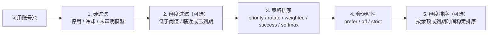

同一个模型挂了多个上游账号时，网关需要在每次请求到来时快速决定先试哪一个、失败后按什么顺序切号。

这个在一次请求里挑账号并排出尝试顺序的过程就是选号。

选号只决定账号顺序，不修改上游协议、请求体或响应体。

## 一次选号怎么走

网关收到请求并确定目标真实模型后，按五个阶段排出最终尝试顺序：



1. **硬过滤**：直接排除已停用、账号级冷却中、未声明该模型，以及该账号-模型正在冷却中的账号。
2. **额度过滤**：仅当显式开启 `--quota-min-usd` 或 `--expiry-mode exclude` 时，排除已知折合余额低于阈值或临近/已到期的账号。
3. **策略排序**：按当前生效策略排出完整候选顺序，而不仅仅是挑出第一个账号。
4. **会话粘性**：存在会话键时，按 `--sticky` 取值决定把哈希命中的账号提到第一位、忽略会话，还是只允许该账号。
5. **额度排序**：仅当显式开启 `--quota-order` 或 `--expiry-mode deprioritize` 时，在前面结果之上做一次稳定排序。

## 策略选择建议

选号策略决定候选账号的基础顺序。刚接入多账号时，先按场景对照选定一种即可：

| 场景 | 推荐策略 | 原因 |
| --- | --- | --- |
| 主备账号，先用完主号再用备用号 | `priority` | 按账号优先级固定排序，行为最可预期 |
| 多个同级账号，希望请求均匀分摊 | `rotate` | 每次请求轮换起始位置，配合 `--sticky off` 效果最好 |
| 账号套餐额度不同，按 3:1 等比例分流 | `weighted` | 按账号权重比例排出完整顺序 |
| 上游稳定性差异大，优先走成功率高的号 | `success` | 按统计窗口内的平滑成功率降序排列 |
| 兼顾优先级、成功率与延迟，并保留探索 | `softmax` | 多维度加权评分后按概率抽样 |

具体参数、公式与账号权重配置见[路由策略与权重](/self-hosted/route/policies)。

## 三层设置与内置默认

选号配置分为三层，模型策略优先于默认策略；模型没有覆盖时回落到默认策略；默认策略未设置时使用内置默认：

| 层级 | 作用 | 命令 |
| --- | --- | --- |
| 默认策略 | 没有模型覆盖时使用 | `lax route set --default` |
| 模型策略 | 只对这一个真实模型生效 | `lax route set <模型>` |
| 账号权重 | 给 `weighted` 与 `softmax` 的分流输入 | `lax route account set` |

额度监控是按账号设置的独立一层，默认只读展示，不参与选号。

只有在策略里显式开启 `--quota-order` 或 `--quota-min-usd` 后，额度才会进入候选过滤与排序。

内置默认值如下：

| 项 | 默认值 |
| --- | --- |
| 策略 | `priority` |
| 会话粘性 | `prefer` |
| 温度 | `0.1` |
| 探索 | `2%` |
| 统计窗口 | `1d` |
| 最小样本 | `20` |
| 评分权重 | 优先级 0.4、成功率 0.5、延迟 0.1 |
| 额度排序 | `off`（不按额度改顺序） |
| 最低折合 USD | `0`（不按余额排除） |

## 常用操作与生效方式

```bash
lax route ls
lax route show deepseek/deepseek-v4.1-flash
lax route show --default
lax route set deepseek/deepseek-v4.1-flash --strategy weighted
lax route unset deepseek/deepseek-v4.1-flash
lax route explain deepseek/deepseek-v4.1-flash --session demo --seed 42
```

| 命令 | 作用 |
| --- | --- |
| `route ls` | 列出默认策略与全部模型覆盖（不显示额度设置） |
| `route show` | 查看目标最终生效的完整设置，末尾另打一行额度设置 |
| `route set` | 写入一条策略，采用**整条覆盖** |
| `route unset` | 删除一条策略，回落到默认或内置默认 |
| `route account` | 查看或修改账号权重 |
| `route explain` | 预演一次选号，不发上游请求、不写记录 |
| `route policy` | 查看与维护上游失败处理规则 |

### 整条覆盖

`lax route set` 采用整条覆盖语义：命令里未指定的参数会恢复内置默认，而不是保留原值。

例如原本设置了 `--min-samples 50` 或 `--quota-order usd_desc`，下一次只执行 `--strategy rotate` 时，最小样本会回到 `20`，额度排序会回到 `off`。

需要保留原有参数时，在命令中一并写出。

### 目标名与别名

`route set` 与 `route show` 接受模型名或别名。

传入别名时，命令会先解析到真实模型名再写入，因此客户端用别名请求也会命中同一条策略。

`route ls` 只列出真实模型，`route show <别名>` 显示解析后真实模型的设置。

### 改完立即生效

选号策略持久化存储，网关每次请求都读取当前快照，改完不需要重启。

`lax route explain` 读取同一份快照与统计数据，因此可以直接在本地预演线上选号结果。

## 与冷却、失败处理和额度的关系

- **冷却决定能不能用**：即使某个账号 `priority` 最小，只要它处于冷却中，就会在硬过滤阶段被排除。冷却默认按「账号 + 模型」记录，互不影响；也可通过失败处理规则配置账号级冷却。
- **失败处理决定出错后怎么办**：选号排出尝试顺序，失败处理规则决定命中错误后是否同账号重试、冷却、停用账号，或者切到下一个候选账号，详见[冷却、重试与选号排障](/self-hosted/route/failure)。
- **额度按需参与过滤与排序**：开启 `--quota-min-usd` 或 `--quota-order` 后，网关会在硬过滤后排除低余额账号，并在策略排序后按余额或到期时间稳定排序，详见[额度感知与优先消耗](/self-hosted/route/quota#参与选号)。

## 下一步

- [路由策略与权重](/self-hosted/route/policies)：查看五种策略参数、计算方式与账号权重配置
- [额度感知与优先消耗](/self-hosted/route/quota)：配置余额监控、低余额排除与到期降权
- [冷却、重试与选号排障](/self-hosted/route/failure)：配置失败处理规则并用 `lax route explain` 排查选号
